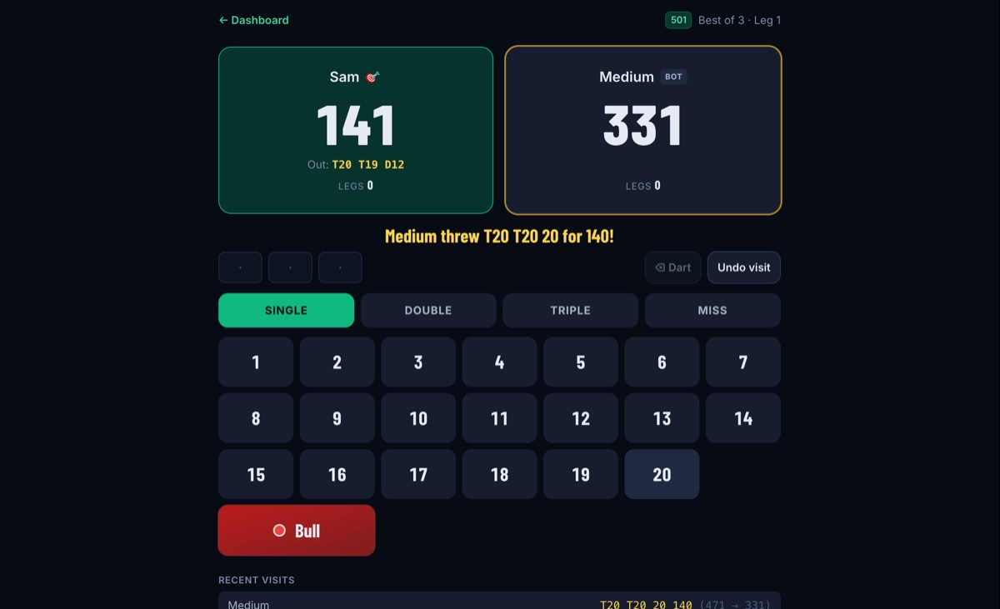
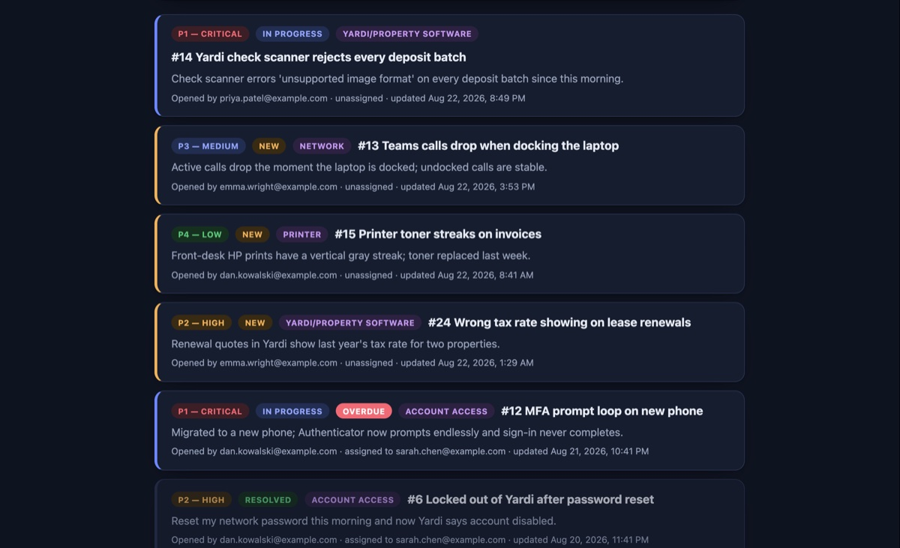

<picture>
  <source media="(prefers-color-scheme: dark)" srcset="assets/header-dark.svg">
  
</picture>

I'm a software engineer who automates the identity layer, and the infrastructure underneath it.
At work, that is Python tooling on the Microsoft Graph API that automates onboarding and
offboarding in a Microsoft 365 tenant of 400+ users across 100+ properties.
I codified that same identity layer as Terraform in a personal sandbox tenant.

I also build and ship full-stack apps in React and FastAPI, both live, with CI/CD behind them.

[pobriendev.github.io/portfolio](https://pobriendev.github.io/portfolio) · patobrien3590@gmail.com

---

### Built

**Identity and infrastructure**

- **[entra-terraform](https://github.com/pobriendev/entra-terraform)** — the identity layer the Graph tools below need, as Terraform in a personal sandbox tenant: app registration with scoped Graph permissions and admin consent as code, a 180-day secret in Key Vault, remote state with Entra-only auth. CI plans every PR over OIDC with no stored credentials and no Azure write roles. 
- **[entra-conditional-access](https://github.com/pobriendev/entra-conditional-access)** — seven Conditional Access policies as reviewed Terraform, deployed in report-only and to be enforced one at a time after validation. Every PR gets a redacted plan and a fail-closed Python guardrail check (40+ tests), apply waits for a required reviewer, and a daily drift job opens one issue when a policy changes in the portal.  
- **[employee-provisioning-tool](https://github.com/pobriendev/employee-provisioning-tool)** — Python CLI that runs the Graph side of Entra ID onboarding and offboarding in one command and prints the remaining Exchange steps: app-only auth for directory writes, dry-run mode, lockout-first offboarding, and an audit log of every completed write. 
- **[entra-credential-monitor](https://github.com/pobriendev/entra-credential-monitor)** — read-only monitor for expiring app secrets, certificates and SAML signing certs that names each credential's owners. Runs daily in GitHub Actions over OIDC with no stored secrets, and keeps one self-closing issue per credential. 90+ tests. 
- **[entra-stale-accounts](https://github.com/pobriendev/entra-stale-accounts)** — `pip install entra-stale-accounts`. Read-only CLI that flags Entra ID accounts inactive past a set threshold, including ones that never signed in.  

**Full-stack apps**

<table>
  <tr>
    <td width="50%"></td>
    <td width="50%"></td>
  </tr>
  <tr>
    <td align="center"><b>DartMetrics</b> · <a href="https://dartmetrics.onrender.com">live demo</a> · <a href="https://github.com/pobriendev/dartmetrics">code</a></td>
    <td align="center"><b>Ticket system</b> · <a href="https://ticket-system-azure-omega.vercel.app">live demo</a> · <a href="https://github.com/pobriendev/ticket-system">code</a></td>
  </tr>
</table>

Both demos run on free tiers that sleep when idle, so the first load can take a minute or two.

- **[dartmetrics](https://github.com/pobriendev/dartmetrics)** — darts scoring platform with a framework-free scoring engine; every dart is stored individually and career stats are derived from the raw darts. 260+ backend tests plus Playwright end-to-end. [Live demo](https://dartmetrics.onrender.com). 
- **[ticket-system](https://github.com/pobriendev/ticket-system)** — helpdesk app in React, FastAPI and PostgreSQL with JWT auth, role-based access, and an audit log of every ticket field change. 175+ backend tests (~96% coverage) and 135+ frontend tests. [Live demo](https://ticket-system-azure-omega.vercel.app). 
- **[ski-resort-explorer](https://github.com/pobriendev/ski-resort-explorer)** — React + Flask REST API serving 423 resorts from MySQL, with live weather and precipitation radar from OpenWeatherMap, proxied through Flask so the API key never reaches the browser.

<!-- next thing goes here -->

### Working with

<picture>
  <source media="(prefers-color-scheme: dark)" srcset="assets/stack-dark.svg">
  
</picture>
